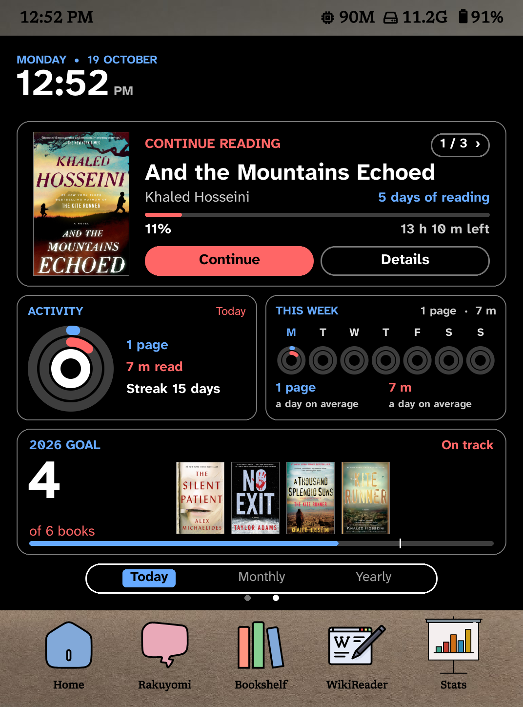
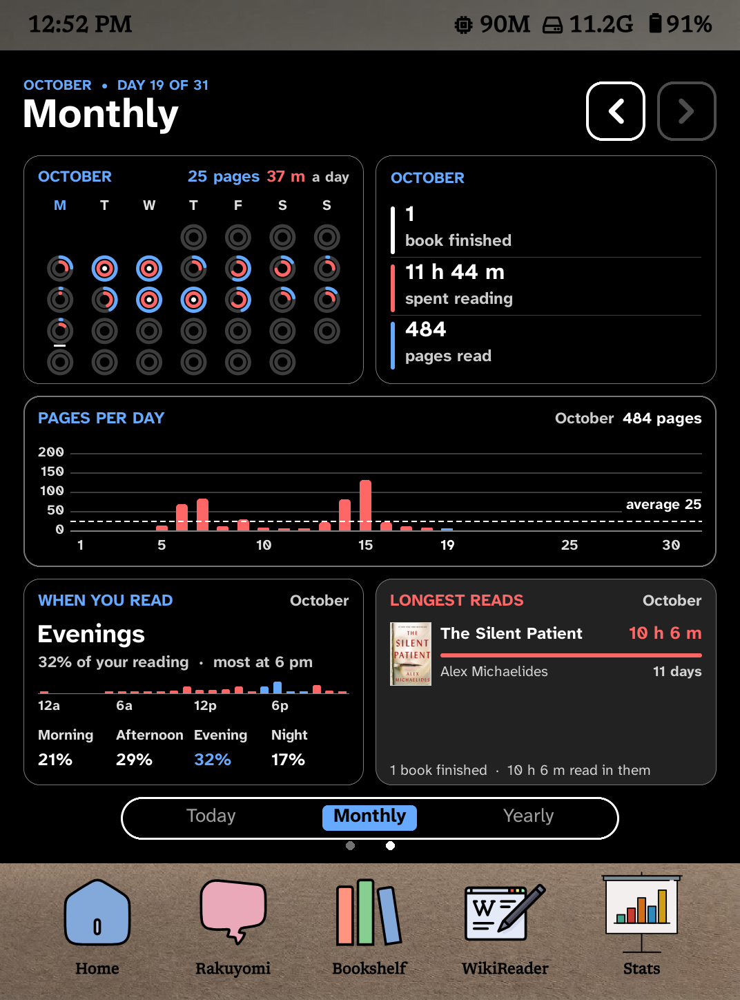
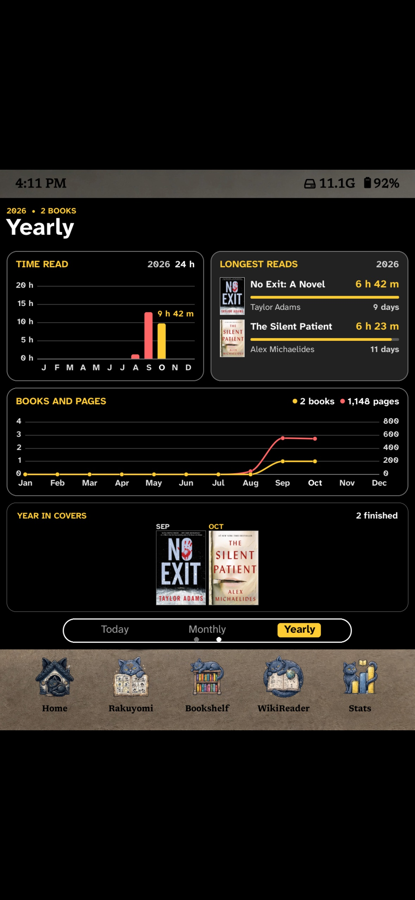
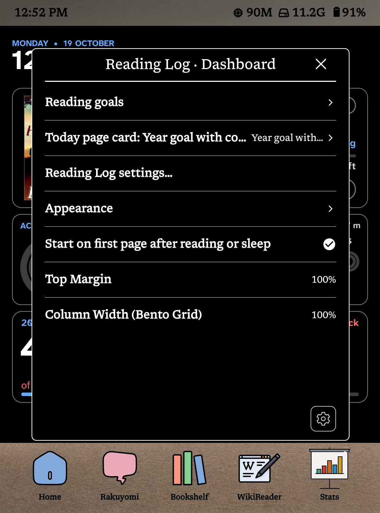

# Reading Log for SimpleUI

Runs [Reading Log](https://github.com/stevenzamora1/reading-log-simpleui) (by stevenzamora1, AGPL-3.0) as SimpleUI home screen modules, with extra layout, night mode and fine-tuning options. No Bookshelf needed.

## Requirements
- KOReader with [SimpleUI](https://github.com/doctorhetfield-cmd/simpleui.koplugin) installed and enabled.
- KOReader's **Reading statistics** plugin switched on (it is by default). Every number on the dashboard comes from it.
- A colour screen is optional. On black-and-white screens the colours show as greys.

## Install
1. Download `simpleui_readinglog.koplugin.zip` from [Releases](../../releases) and unzip it.
   Don't use GitHub's green **Code → Download ZIP**: that folder has the wrong name and won't load.
2. Copy the `simpleui_readinglog.koplugin` folder into `koreader/plugins/` (next to `simpleui.koplugin`).
3. Restart KOReader.

## Updating
1. Delete the old `simpleui_readinglog.koplugin` folder from `koreader/plugins/`.
2. Copy the new one in and restart KOReader.

Copying over the old folder can leave the old version running. Your settings are kept either way, because they live in `koreader/settings/simpleui_readinglog.lua`.

## Screenshots

## Put the dashboard on page 2
1. Simple UI → Home Screen → Modules: set **Number of Pages** to 2.
2. Tick **Reading Log · Dashboard**.
3. **Arrange Modules**: move the Dashboard to page 2, alone.
4. If it overflows or leaves a gap: Module Settings → Reading Log · Dashboard → **Appearance → Height (% Of Screen)**.

The Today / Monthly / Yearly / Trends / Library tabs and the month arrows work by tap. Swipe still turns SimpleUI pages.

Every card is also available as its own module (`Reading Log · Activity Rings`, etc.).

## The cards

| Today | Monthly | Yearly | Trends | Library |
| --- | --- | --- | --- | --- |
| Banner | Month Rings | Time Read By Month | Reading Trends | Library Stats |
| Continue Reading | Month Totals | Longest Reads (Year) | This Week Vs Last | Most-Read Authors |
| Activity Rings | Pages Per Day | Books And Pages | Finish Forecast | Random Pick |
| Week Rings | When You Read | Year In Covers | | Quote Of The Day |
| This Week | Longest Reads (Month) | Top Genres | | |
| Year Goal | Monthly Challenge | Reading Heatmap | | |
| Year Goal With Covers | | Recently Finished | | |
| Book Club | | | | |
| Today's Timeline | | | | |
| Control Centre | | | | |

Plus **Mini Dashboard** (one row of up to three small cards for the top of the home screen), **TBR Shelf** and **Finish By**.

## Settings
All of these are in Module Settings → Reading Log · Dashboard.

| Setting | What it does |
| --- | --- |
| **Reading Goals** | Books this year, read outside KOReader, minutes a day, pages a day. Books and minutes are SimpleUI's own Annual and Daily goals (Simple UI → Stats), so changing them in either place changes both. |
| **Today Page Card** | The card under the rings on the Today tab: Year Goal With Covers (default), Year Goal, Book Club, Recently Finished or TBR Shelf. |
| **Reading Log Settings** | Pages and cards (any card on any page, up to 7 tabs, move or remove pages, put it all back), margin, each card's own options, card colour, Look and colours (theme, accents, week start). |
| **Quote Of The Day** | Where the quote comes from: **My Quote File** (default; a quote file in `koreader/settings/simpleui/sui_quotes/`, the same folder SimpleUI's Quote of the Day uses) or **My Highlights**. Pick which file underneath. |
| **Appearance → Layout** | **In The Page** (default) sits in SimpleUI's page like any module. **Full Screen** fills everything between the status bar and the nav bar, so every card is bigger. |
| **Appearance → Bottom Space** | Full Screen only. Room left under the dashboard for SimpleUI's page dots. **Auto** fits the dots; add or take away pixels to fine-tune. |
| **Appearance → Size** | Scales the text. Small labels scale fully, big numbers and titles at half strength. Rings, charts and covers follow the card's size, so use Height for those. |
| **Appearance → Height (% Of Screen)** | How much of the page the dashboard fills. |
| **Appearance → Night Mode Theme** | The theme used while night mode is on: Dark (default), Paper, White or Same As Day. |
| **Appearance → Flash To Clear Ghosting** | Flashes the screen when you switch tabs or turn onto or off the dashboard page, so the old page doesn't linger. Turn it off for faster tab switches at the cost of some ghosting. |
| **Appearance → Live Clock** | The Banner and Today tab clock update every minute while they're on screen (on by default). Off: the clock updates whenever the page redraws. |
| **Start On First Page After Reading Or Sleep** | Opening a book or putting the device to sleep sends the home screen back to page 1. |

## Notes
- **Book Details:** "Details" on a book opens SimpleUI's own book menu (mark finished or on hold, collections, book info…).
- **Finish dates:** reopening a finished book for a moment can make KOReader mark it finished again with today's date. Reading Log ignores that and uses the last day of real reading (at least 1 minute or 2 pages), so Longest Reads, the monthly lists and Year In Covers stay correct. If Bookshelf is also installed, its own Reading goals card still uses KOReader's date and may count that book in the wrong month.
- **Redrawing:** tabs, month arrows and data updates redraw only the dashboard, not the whole home page. The hidden tabs are pre-loaded a few seconds after the dashboard first shows.
- **Clock:** with Live Clock on, the Banner and Today tab clock update every minute, redrawing only the clock. It only runs while the clock is on screen: not while you read, on another home page or another tab, and it stops on sleep and restarts on wake.
- **Quote files:** Lua files returning `{ { q = "Quote", a = "Author", b = "Book (optional)" }, ... }`, like `Quotes.lua` from [KOReader patches](https://github.com/BrownTigerz/-KOReader.patches). "Another" on the card shows the next one; one quote a day otherwise.

## Credits
The Reading Log kit (`readinglog/almanac/`) is [Reading Log for Simple UI](https://github.com/stevenzamora1/reading-log-simpleui) by stevenzamora1 (AGPL-3.0), from [Reading Log](https://github.com/stevenzamora1/reading-log). Thank you! The SimpleUI integration (`main.lua`) is new work by TK, also AGPL-3.0. Full license text: `LICENSE`.
