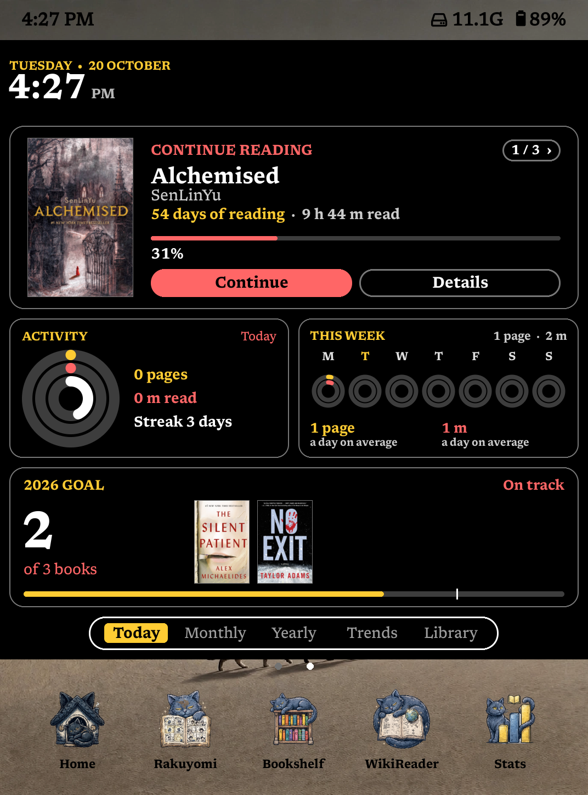
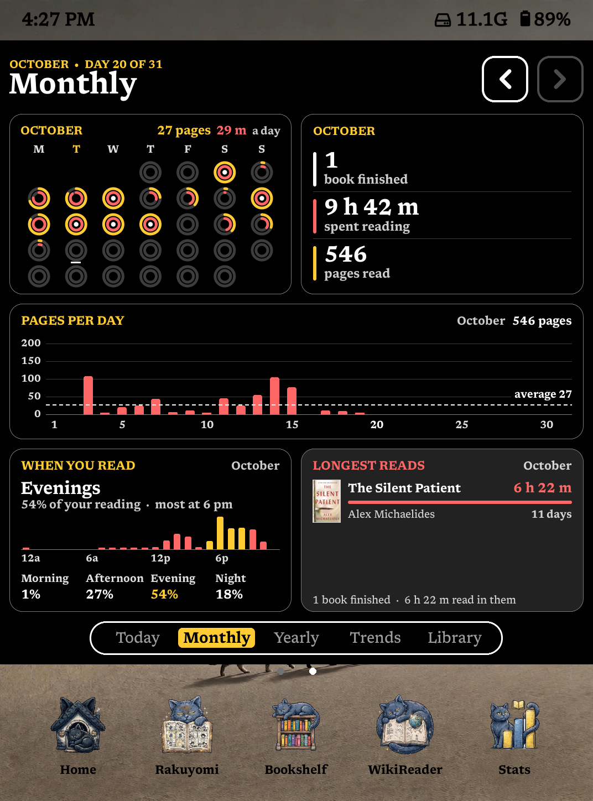
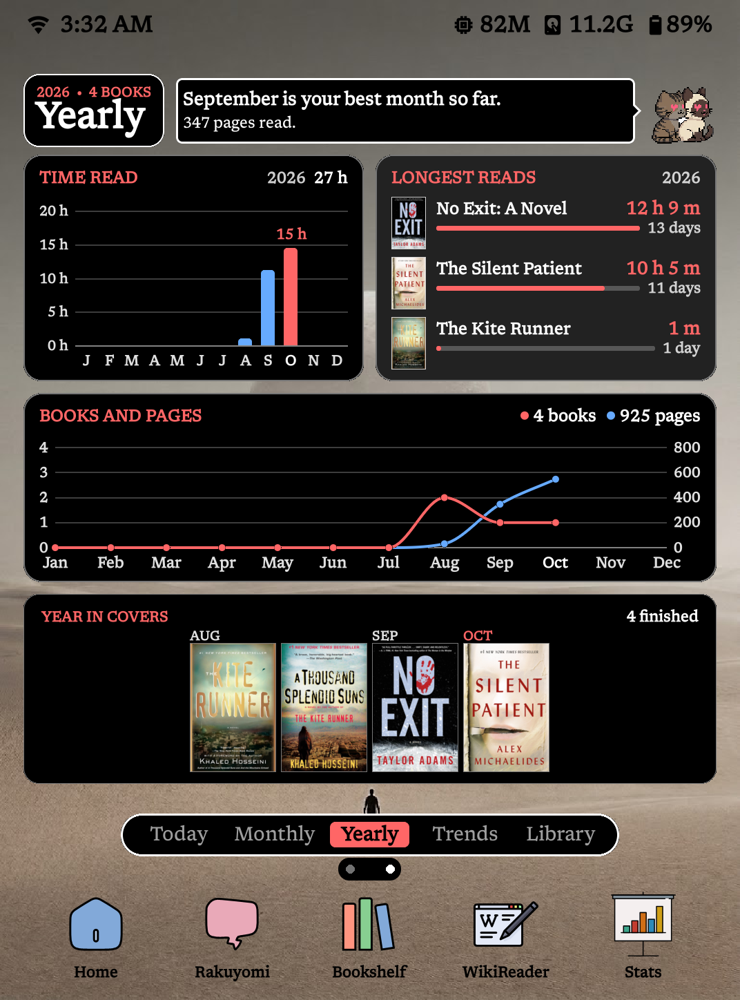
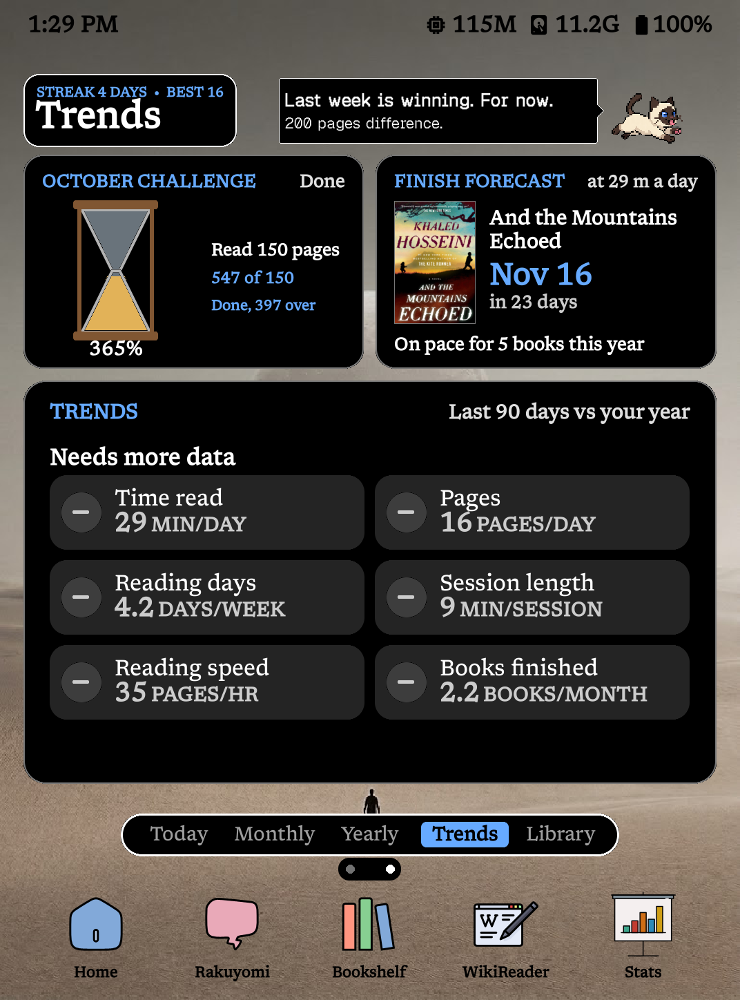
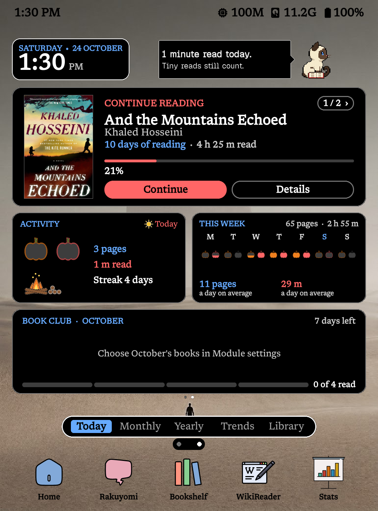
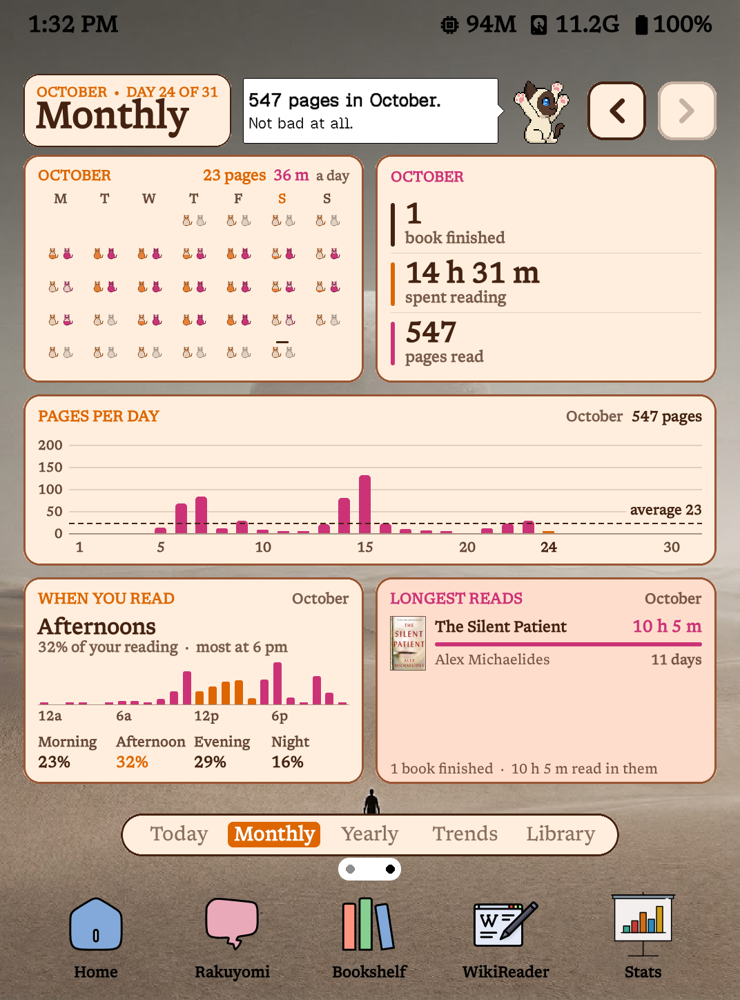
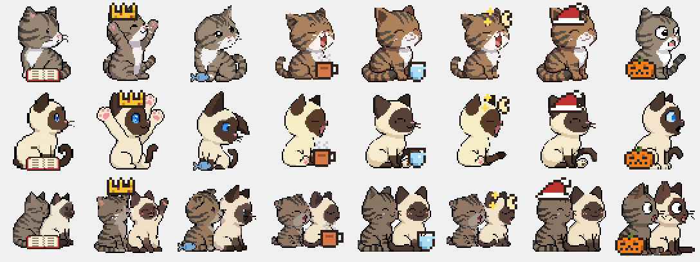

# Reading Log for SimpleUI

Runs [Reading Log](https://github.com/stevenzamora1/reading-log-simpleui) (by stevenzamora1, AGPL-3.0) as SimpleUI home screen modules, with extra layout, night mode and fine-tuning options. No Bookshelf needed.

## Requirements
- KOReader with [SimpleUI](https://github.com/doctorhetfield-cmd/simpleui.koplugin) installed and enabled.
- KOReader's **Reading statistics** plugin switched on (it is by default). Every number on the dashboard comes from it.
- A colour screen is optional. On black-and-white screens the colours show as greys.

## Install
1. Download `simpleui_readinglog.koplugin.zip` from [Releases](../../releases) and unzip it.
   Don't use GitHub's green **Code → Download ZIP**: that folder has the wrong name and won't load.
2. Copy the `simpleui_readinglog.koplugin` folder into `koreader/plugins/` (next to `simpleui.koplugin`).
3. Restart KOReader.

## Updating
1. Delete the old `simpleui_readinglog.koplugin` folder from `koreader/plugins/`.
2. Copy the new one in and restart KOReader.

Copying over the old folder can leave the old version running. Your settings are kept either way, because they live in `koreader/settings/simpleui_readinglog.lua`.

## Screenshots

## Put the dashboard on page 2
1. Simple UI → Home Screen → Modules: set **Number of Pages** to 2.
2. Tick **Reading Log · Dashboard**.
3. **Arrange Modules**: move the Dashboard to page 2, alone.
4. If it overflows or leaves a gap: Module Settings → Reading Log · Dashboard → **Appearance → Height (% Of Screen)**.

The Today / Monthly / Yearly / Trends / Library tabs and the month arrows work by tap. Swipe still turns SimpleUI pages.

Every card is also available as its own module (`Reading Log · Activity Rings`, etc.).

## The cards

| Today | Monthly | Yearly | Trends | Library |
| --- | --- | --- | --- | --- |
| Banner | Month Rings | Time Read By Month | Reading Trends | Library Stats |
| Continue Reading | Month Totals | Longest Reads (Year) | This Week Vs Last | Most-Read Authors |
| Activity Rings | Pages Per Day | Books And Pages | Finish Forecast | Random Pick |
| Week Rings | When You Read | Year In Covers | | Quote Of The Day |
| This Week | Longest Reads (Month) | Top Genres | | |
| Year Goal | Monthly Challenge | Reading Heatmap | | |
| Year Goal With Covers | | Recently Finished | | |
| Book Club | | | | |
| Today's Timeline | | | | |
| Control Centre | | | | |

Plus **Mini Dashboard** (one row of up to three small cards for the top of the home screen), **TBR Shelf** and **Finish By**.

## Settings
All of these are in Module Settings → Reading Log · Dashboard.

| Setting | What it does |
| --- | --- |
| **Reading Goals** | Books this year, read outside KOReader, minutes a day, pages a day. Books and minutes are SimpleUI's own Annual and Daily goals (Simple UI → Stats), so changing them in either place changes both. **Book Club** is here too: its collection, this month's picks and its title. |
| **Today Page Card** | The card under the rings on the Today tab: Year Goal With Covers (default), Year Goal, Book Club, Recently Finished or TBR Shelf. Turn on **Swipe Between 2-3 Cards** at the top, then tick up to 3 of those cards to swipe between (a 4th replaces the oldest). |
| **Today Page Card → Alternate Or Keep Last** | With swipe on: **Alternate** shows the next card each time you come back from a book or sleep; **Keep Last** (default) stays on the one you swiped to. |
| **Today Page Card → Flash On Swipe** | Flashes the card when you swipe, to clear ghosting. Off by default: a swipe then takes about 0.2 s; with the flash, about 0.6 s. |
| **Reading Log Settings** | Pages and cards (any card on any page, up to 7 tabs, move or remove pages, put it all back), margin, each card's own options, card colour, Look and colours (theme, accents, week start). Accents include **Black**, which shows as white on the Dark theme so it stays visible. |
| **Reading Log Settings → Look And Colours → Theme** | White, Dark, Paper, and from 1.9.0 **Forest** (soft greens), **Latte** (warm browns) and **Night Sky** (deep blue, also a Night Mode Theme choice). From 1.10.0 **Cat** (cream and ginger, pink second accent), **Cat (Night)** (a cosy dark brown) and **Latte (Night)** (coffee brown). On a black-and-white screen they show as light or dark greys. |
| **Look And Colours → Progress Style** | How every ring is drawn (Activity, Week and Month rings, Challenge, the Today rings): **Rings** (default), **Bars** (the rings of a card as stacked bars; a single ring becomes one bar under its figure), **Dots** or **Pixel Blocks** (the ring as a circle of dots or squares that light up), **Moons** (each ring a moon, new to full; a card's first ring the big moon, the others small moons beside it) **Batteries** (each ring a battery charging up cell by cell, with a lightning bolt when the goal is met), and from 1.10.0 **Seasonal** (each ring an icon that fills from the bottom: a snowflake in January, a heart in February, a shamrock, a raindrop, a flower, the sun, a maple leaf for July, a sailboat, an apple, a pumpkin, a poppy for November and a Christmas tree in December, whose star lights up when it's full), **Potion Vials** (a flask filling up, with a cork and bubbles), **Bookmark Ribbons** (a ribbon hanging down as far as your progress) or **Scrolls** (a scroll unrolling as you go), **Cats** (sitting cats that fill up from their paws to their ears) or **Paw Prints** (the ring as a circle of paw prints that light up). |
| **Look And Colours → Seasonal Icon** | With Seasonal: **By Month** (default) changes the icon with the calendar, or pick one to keep all year. |
| **Look And Colours → Card Looks** | Pictures instead of a card's usual chart, each on its own, or a set at once. **Year Goal**: Number (default), **Constellation** (a star lights up for each book you finish, joined into a constellation in the order you finished them; the same sky all year, a bigger star when the goal is reached) or **Critter Trail** (your SimpleUI Tiny Critter walking up a hill trail to a flag at the top, as far along as your books; asleep at the start, happy, curious when behind, partying at the top). **Monthly Challenge**: Ring or **Hourglass** (the month's sand running down; the % under it). **This Week**: Chart or **Weather** (sun for a day you met your goal, sun and cloud for some reading, rain for none, a dot for days to come). **Time Read By Month**: Chart or **Tree Rings** (a stump with a growth ring per month, as wide as that month's reading, the widest shaded; named beside it). **Streak**: Ring, **Ball Of Yarn** (a ball of yarn that grows with your streak, sparkles at 3 days, a second colour wound in at 7, an unravelled thread when the streak ends) or **Campfire** (the activity rings' third ring becomes a campfire that grows with your streak and burns down to embers when it ends; in the middle of the rings, or beside the other styles' pictures). From 1.10.0 the fire throws sparks at 3 days in a row and glows bigger at 7. **Campfire Woodpile**: On (default) or Off: up to 4 logs beside the fire for the minutes left to your daily goal, burning down as you read, gone when the goal's met (needs a minutes goal). **Time Of Day**: Off (default) or On: a small picture by the Activity card's heading: a steaming mug in the morning (5 to 11), the sun in the afternoon, a lamp in the evening (5 to 9 PM), the moon and stars at night. **Sets**: **Night Sky** (moons, constellation, hourglass), **Trail** (critter trail, weather, tree rings, campfire), the presets (they pick the theme too) **Cozy Cabin** (Latte, batteries, campfire and woodpile, critter trail, hourglass, weather, tree rings, time of day), **Midnight Reader** (Night Sky, moons, line charts, constellation, hourglass, time of day), **Minimal Focus** (White, dots, dots-on-stems charts, no pictures), **Seasonal** (seasonal icons, campfire, time of day), **Cat Lover** (Cat theme by day and night, cats, ball of yarn, critter trail, hourglass, weather, time of day), and **Everything Back To Normal**. The presets also set the Night Mode Theme to a dark version of their own, so they work in night mode too. Drawn as shapes, so they work on black-and-white too. |
| **Look And Colours → Chart Style** | How the bar charts are drawn (time read by month, month chart, this week, when you read): **Bars** (default), **Line** (a line through dots) or **Dots On Stems**. |
| **Quote Of The Day** | Where the quote comes from: **My Quote File** (default; a quote file in `koreader/settings/simpleui/sui_quotes/`, the same folder SimpleUI's Quote of the Day uses) or **My Highlights**. Pick which file underneath. |
| **Appearance → Layout** | **In The Page** (default) sits in SimpleUI's page like any module. **Full Screen** fills everything between the status bar and the nav bar, so every card is bigger. |
| **Appearance → Bottom Space** | Full Screen only. Room left under the dashboard for SimpleUI's page dots. **Auto** fits the dots; add or take away pixels to fine-tune. |
| **Appearance → Tab Bar Position** | Moves the Today / Monthly / Yearly tab bar up (-) or down (+) by pixels from where it normally sits, e.g. to line it up over a wallpaper. Only the tab bar moves: the date, time and page title at the top stay where they are and the same size, and the cards make room. It can only go down into the dashboard's margin. |
| **Appearance → Size** | Scales the text. Small labels scale fully, big numbers and titles at half strength. Rings, charts and covers follow the card's size, so use Height for those. |
| **Appearance → Height (% Of Screen)** | How much of the page the dashboard fills. |
| **Appearance → Night Mode Theme** | The theme used while night mode is on: Dark (default), Night Sky, Paper, White, **Cat**, **Latte** or Same As Day. The presets set it too, so they look right in night mode: Cozy Cabin → Latte, Midnight Reader → Night Sky, Minimal Focus and Seasonal → Dark, Cat Lover → Cat. |
| **Appearance → Flash To Clear Ghosting** | Flashes the screen when you switch tabs or turn onto or off the dashboard page, so the old page doesn't linger. Turn it off for faster tab switches at the cost of some ghosting. |
| **Appearance → Live Clock** | The Banner and Today tab clock update every minute while they're on screen (on by default). Off: the clock updates whenever the page redraws. |
| **Reading Log Settings → Critter Remarks** | SimpleUI 3.0's Tiny Critter peeks into each Dashboard page with a remark about that page's numbers (on by default). See **Tiny Critter** below. |
| **Start On Tab** | Which tab shows when you come back to the dashboard (turning onto its page, after a book or sleep): **Last Viewed** (default) or a tab of your choice, e.g. Today. |
| **Start On First Page After Reading Or Sleep** | Opening a book or putting the device to sleep sends the home screen back to page 1. |

## Tiny Critter
With SimpleUI 3.0's **Tiny Critter**, the critter peeks into every Dashboard page and says something about that page's numbers:

| Page | It talks about |
| --- | --- |
| **Today** | Your daily goal (done, or how much is left), your best reading day this month, a first reading day after a break or a few days in a row since, a day well above your usual, a streak that needs a page today or is close to your best, the book closest to done (and the time left in it), this week against last week |
| **Yearly** | Ahead of or behind your goal pace, the finish rate your goal needs ("one every 3 days"), a milestone (book 5, 10, 25, 50, 75, 100 this year), where the year is heading at this rate, your best month so far, a month beating every other this year, goal reached |
| **Monthly** | Books finished this month, how many more would put you on your yearly pace, your best day this month, already past last month, pages to an average month, the last days of the month and the book you could finish in them |
| **Trends** | Your streak against your best, getting back into the habit, whether you read more on weekends or weekdays, the hour you read most, this week against last, your pages and minutes a day lately |
| **Library** | Unread books waiting, unread books by authors you've finished, how much of your library you've read, books on the go at once, books on hold, the next one to finish |
| **Pages you added** | A mix of Today, Yearly and Library remarks |

It also **suggests books**, worked out from your stats. **Tap the critter or its bubble** and it talks back, in SimpleUI's own critter conversation: over a book suggestion, **Open It**, **Another Suggestion** or **Say Something Else**; over any other remark, it offers to **Suggest A Book**, or **Not Now** / **Say Something Else**. A long remark makes the bubble wider (up to all the room in the row) before anything is cut short.

| Suggestion | Where | Example |
| --- | --- | --- |
| An author you finish, with a book of theirs you haven't started | Yearly, Library | "More Alex Michaelides? “The Maidens” is on your shelf." |
| The next book of a series you finished one of lately (comes first) | Today, Yearly, Library | "Ready for more Dresden? “Storm Front 2” is next." |
| The next book of a series you've read | Yearly, Library | "Next in Dresden: “Storm Front 2”." |
| A book you're 25 minutes or less from finishing | Today, Monthly | "Only 15 m left in “The Hobbit”. A little time to spare?" |
| A book you left two weeks or more ago, well under way | Today, Library | "You were 41% into “And the Mountains Echoed”. Give it another chapter?" |
| A few quiet days: the book you were on | Today, Trends | "3 quiet days. Fancy a few pages of “The Hobbit”?" |
| After three finished books of one genre, a book from another genre you like | Library | "Three thriller books in a row. Something different? “Kite 3”." |
| A genre you keep finishing, with a book in it you haven't started | Monthly, Library | "You keep finishing thrillers. Try “The Maidens”?" |
| A book on hold, and how far in you were | Today, Library | "Pick “Dune” back up? You were 40% in." |
| A book you could finish today, at your usual pace | Today, Monthly | "“The Hobbit” could be done today. About 45 m left. Your usual day is 40 m." |
| How much sooner 10 more minutes a day would finish a book | Today, Trends | "10 more minutes a day finishes “And the Mountains Echoed” 4 days sooner." |
| Your best reading hour, before it comes round | Today, Trends | "Your best reading time is around 6 PM." |
| Something you've never opened | Library | "Something new? “Sea of Poppies”, never opened." |

With **ReadMastery** and its Quests patch (1.0.6+, Quests (Enhanced) on) it blends in your quests: today's daily quest and the book that would complete it ("Quest: Daily Chapter, 10 of 25 pages. “The Hobbit” would do it."), and a weekly or monthly "finish a book" quest one book short near its end ("Bibliophile needs one more book. “The Hobbit” is 91% done."). Without ReadMastery those simply don't come up.

The book each suggestion picks stays the same all day, and changes the next. A book you pass on with **Another Suggestion** isn't suggested again that day.

The insights only come up when your stats back them:

- **Best day this month** is in minutes read: 20+ minutes, a week into the month, and more than each of 5+ earlier reading days this month.
- **Comeback / back on a roll:** 4+ quiet days before it. It comes first once per comeback; after that it's an ordinary remark.
- **Milestones** (book 5, 10, 25, 50, 75, 100 this year) go by the date the book was finished: first on that day, then an ordinary remark for 3 days.
- **Goal pace** (Yearly, from mid-January): books left over days left ("20 books to go, 69 days left. About one every 3 days catches you up."), worded for on pace or catching up. Monthly keeps "2 more books this month would put you on pace".
- **Weekend reader** needs 4+ weekend and 8+ weekday reading days in the last 8 weeks and a clear difference, and the verdict sticks until the difference is mostly gone, so it doesn't flip every week.
- **Quiet days:** passing on that nudge (Another Suggestion) keeps it away for the rest of that quiet stretch.

The big news of the day (daily goal done, a milestone, your best day, a record streak, a comeback, the next in a series you just finished) comes first, once a day on each page.

- It sits in the free part of a page's title row, and wanders: right after the title, the middle or the far end, a different spot each day (and on each page), and a new one each time you tap it. It never fills the whole row. On Monthly the month arrows leave it less room.
- **Today:** the Banner (day and clock) is that page's title row, so the critter wanders in the room to the right of the clock. It needs the Banner's **Heading** style (the default) with its two lines of your own left empty. If you've filled those lines in, turn on Today's own title (Pages and cards → Today → **Title on the page**) and it wanders there instead. It never takes a row of its own.
- **Pep talk (Today):** once you've read a minute, Today's remark says how much, and grows with it: a nudge at 1 to 4 minutes ("A start is a start."), a groove at 15, a cheer at half an hour, a party past an hour, gentle stretch-and-water jokes past two. Within 10 minutes of your daily goal it counts you in. A "pages turned today" one comes round too. The number stays live, the wording changes each day and when you tap.
- **More wordings (1.10.0):** the record day, back on a roll, a book nearly done, a quiet stretch, milestones, goal pace and weekend reading also use the lines in `critter-phrases.lua`, the file SimpleUI Tweaks uses: `koreader/patches/critter-phrases.lua` if you have it (edit that one and both critters change), else the copy that comes with Reading Log. A broken or missing file leaves the built-in lines.
- **More moods (1.10.0):** reading, proud, hungry, cozy, sipping, dreamy, festive and spooky, on top of SimpleUI's twelve. Donny and Blu have pictures for them (critters.zip in KOReader patches); another critter shows the pose they're drawn from (reading as neutral, proud as cheer...).
- **Critter Mix:** with SimpleUI Tweaks 2.14.2+ and two or more critters ticked in its Critter Mix (say Donny, Blu and Donny & Blu), the dashboard's critter takes turns as well: a new remark or a tap brings the next one.
- It's your critter, in SimpleUI's bubble style and text sizes, and in a mood that follows SimpleUI's: a grumpy critter doesn't throw a party.
- Each page keeps its remark for the day, with its numbers kept current. Tap the critter to talk to it (see below), or **Say Something Else** for another remark. Most remarks have two or three wordings, and a critter in a strong mood (grumpy, sleepy, radiant) says some its own way. A remark doesn't come round again before the others on that page have been seen, nor a wording before the others.
- Nothing moves and nothing runs on a timer. Without SimpleUI 3.0's Tiny Critter it doesn't show, and the pages look as before.
- Turn it off in Reading Log Settings → **Critter Remarks**. Under it, **Statistics Remarks**, **Book Suggestions** and **Streak Remarks** turn those off on their own (say, suggestions without the streak talk).

## Notes
- **Wallpaper:** with a SimpleUI wallpaper on, the dashboard follows its **Background Opacity** (long-press → Background). Below Solid, the dashboard's page is left clear so the wallpaper shows around and between the cards; the cards and the tab bar stay solid so they stay readable, and the date, time and page titles at the top get a framed plate behind them. At Solid it looks as before. (From Steven's Reading Log for Simple UI 1.2.0.)
- **Book Details:** "Details" on a book opens SimpleUI's own book menu (mark finished or on hold, collections, book info…).
- **Finish dates:** reopening a finished book for a moment can make KOReader mark it finished again with today's date. Reading Log ignores that and uses the last day of real reading (at least 1 minute or 2 pages), so Longest Reads, the monthly lists and Year In Covers stay correct. If Bookshelf is also installed, its own Reading goals card still uses KOReader's date and may count that book in the wrong month.
- **Swipe cards:** swipe left or right on the card, or tap the dots under it, to switch. Only that card redraws. A swipe anywhere else still turns SimpleUI pages, so start page-turn swipes off the card.
- **Continue Reading:** **Continue** opens the book and **Details** its menu; a tap anywhere else on the card does nothing (from 1.10.0). On a card too small for the buttons, the cover opens the book.
- **Book Club:** hold the card (on its own or in the Today swipe card) to tick this month's books, the same list as in its settings; the arrows there line up next month's.
- **Redrawing:** tabs, month arrows and data updates redraw only the dashboard, not the whole home page. The hidden tabs are pre-loaded a few seconds after the dashboard first shows, and each tab you've visited is kept ready for a minute, so switching back (or turning back onto the page) shows it straight away. New data, a setting, the theme, night mode, the clock's minute or a tap inside a card (Continue Reading's **1/2 ›**, **Another** on a pick or quote) draws it fresh; opening a book or sleep lets them go.
- **Clock:** with Live Clock on, the Banner and Today tab clock update every minute, redrawing only the clock. It only runs while the clock is on screen: not while you read, on another home page or another tab, and it stops on sleep and restarts on wake.
- **Quote files:** Lua files returning `{ { q = "Quote", a = "Author", b = "Book (optional)" }, ... }`, like `Quotes.lua` from [KOReader patches](https://github.com/BrownTigerz/-KOReader.patches). "Another" on the card shows the next one; one quote a day otherwise.

## Credits
- **[Simple UI](https://github.com/doctorhetfield-cmd/simpleui.koplugin)** by Doctor Hetfield: the home screen this plugin lives in. Reading Log uses its module system, wallpaper and Background Opacity, book menu, cover cache, Reading goals and quote file folder. Thank you!
- **[Reading Log for Simple UI](https://github.com/stevenzamora1/reading-log-simpleui)** by stevenzamora1 (AGPL-3.0), from his [Reading Log](https://github.com/stevenzamora1/reading-log): the Reading Log kit (`readinglog/almanac/`), all the cards, themes and the dashboard. The wallpaper support (page left clear below Solid, plates behind the titles) comes from his version 1.2.0. Thank you!
- **[KOReader](https://github.com/koreader/koreader)** and its Reading statistics, where all the reading data comes from.
- **TK:** the SimpleUI integration (`main.lua`), also AGPL-3.0: swipe cards, kept tabs, Start On Tab, the Black accent, Book Club in Reading Goals, the finish-date correction and the redraw and speed work.

